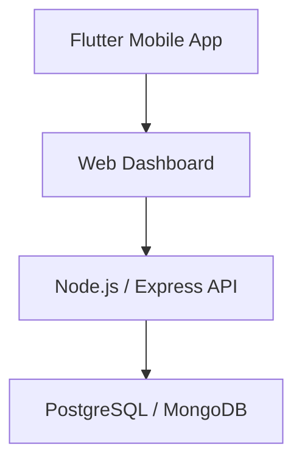
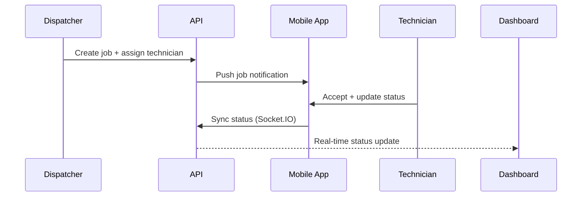

# Architecture

## System overview

| Layer | Responsibility |
|---|---|
| Flutter Mobile App | Technician job view, status updates, signatures, photo capture |
| Web Dashboard | Dispatcher scheduling and job tracking |
| Node.js / Express API | Job and scheduling backend |
| PostgreSQL / MongoDB | Job, customer, and scheduling data |

## Job assignment flow

